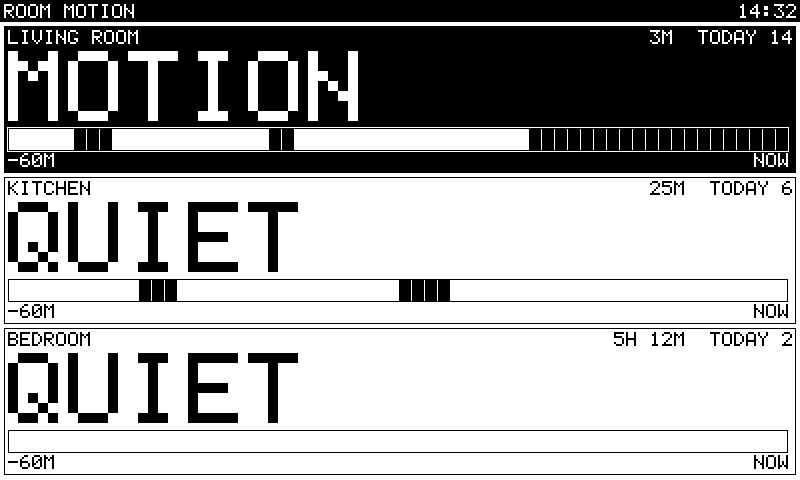

# Room motion on a TRMNL X (Raspberry Pi 4)

Rooms as large boxes, MOTION or QUIET in big type, the time since the change, today's count, and the last 60 minutes as
a strip (one slot per minute, black = motion). Motion comes from [ESPectre](https://github.com/francescopace/espectre)
sensors (ESP32 Wi-Fi motion detection) over MQTT. The page is redrawn when a room changes and once a minute; the device
refreshes only what changed.

## Buy

| What | How many |
|---|---|
| Raspberry Pi 4 (arm64, Raspberry Pi OS 64-bit, Docker installed) | 1 |
| TRMNL X running the tiny-paper display firmware, on the Pi's USB port | 1 |
| ESP32-S3 or ESP32-C6 board for ESPectre | 1 per room |

Flashing and setting up ESPectre is their project's job: follow its documentation, and point it at the Pi's MQTT broker
(host = the Pi's address, port 1883).

## Set the topics

The topic and payload that ESPectre publishes are not verified here: look at what arrives and write it in `config.yml`.

    mosquitto_sub -h <pi address> -t '#' -v      (or: docker compose exec mosquitto mosquitto_sub -t '#' -v)

Per room: `name`, `topic` (a Home Assistant style `state_topic` works too), and one of: nothing (plain ON/OFF, true/false,
1/0), `field` (a JSON field, `a.b` for a nested one), `payload_on` / `payload_off` (extra words). Broker login:
`mqtt.user` / `mqtt.password`. Without a file, the variable `ROOMS="Living=espectre/living/motion,Kitchen=t2|motion"`
and `MQTT_HOST` do the same. Set `TZ` in `docker-compose.yml` to your zone (clock and "today").

## Run

    cd python/examples/motion
    docker compose up -d                      # broker + display
    docker compose --profile demo up          # also fake motion for three rooms (needs the device too)
    docker compose logs -f motion-display

No device or broker, just the picture: `python motion_display.py --png page.png --size 1872x1404 --demo`.

The compose file maps `/dev/ttyACM0`. If the X shows up as another name, check `ls /dev/ttyACM*` and edit the line.
Docker reaches it as root, so no extra rights are needed; to run the script outside Docker, add your user to the
`dialout` group. The container restarts on its own; the display and the broker are reconnected with a growing pause.

## Privacy

Wi-Fi motion sensing sees movement through walls. Use it only in your own home, with everyone who lives there or visits
aware of it, and keep the broker on the home network (do not forward port 1883).

## Files

| File | What |
|---|---|
| `motion_display.py` | broker in, page out |
| `simulator.py` | fake motion, profile `demo` |
| `config.yml` | rooms and broker |
| `mosquitto.conf` | minimal broker settings, for the home network |
| `Dockerfile` | python:3.12-slim, amd64 and arm64; build context is the repository root |
